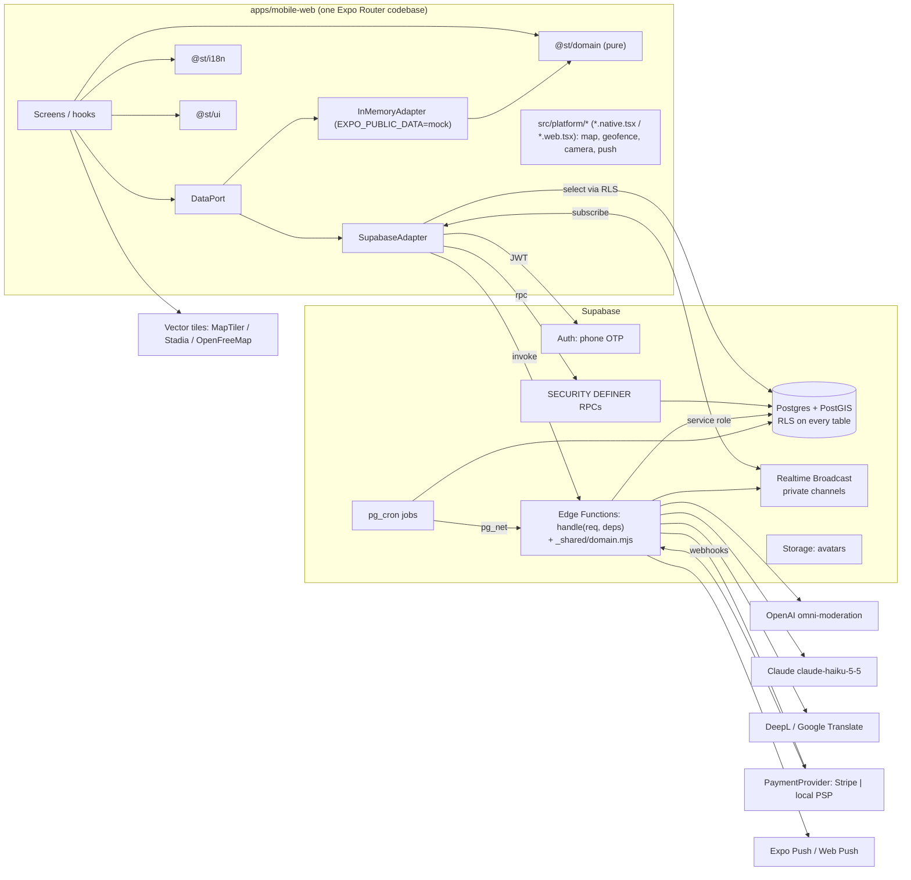
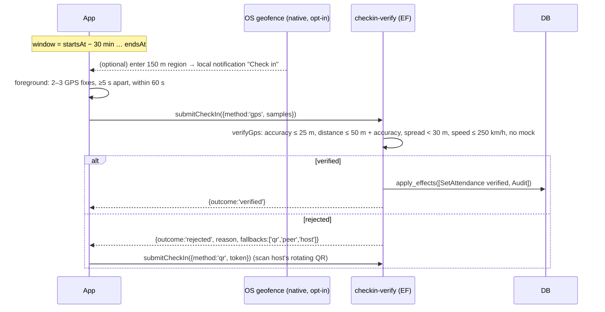

# Sport Talent: System Architecture

Status: approved for MVP (M1a). Owner: Architect. Related: [plan](plan.md), [research](research/findings.md), ADRs in [adr/](adr/).

The shared contract is code, not prose: `packages/domain/src/types.ts` (entities, enums, `TrustConfig`, engine `Effect`s, `ErrorCode`) and `apps/mobile-web/src/data/DataPort.ts` (the app's data surface). When this document and those files disagree, the files win and this document gets fixed.

## 1. Overview



Plain-text summary:

```
 Expo app (web / iOS / Android)
   screens → DataPort ─┬─ SupabaseAdapter ──► Auth · RLS selects · RPCs · Edge Functions · Realtime
                       └─ InMemoryAdapter  ──► @st/domain (same rules, in memory)
 Supabase: Postgres+PostGIS (RLS) · SECURITY DEFINER RPCs · Edge Functions (pure handle(req,deps)) · pg_cron
 Vendors (server side only): OpenAI moderation · Claude Haiku · DeepL/Google · Stripe/local PSP · Expo Push
```

## 2. Platform strategy

- **One codebase, three targets.** A single Expo SDK 58 app with Expo Router serves web (static export), iOS and Android. Web is a first-class target and is the one fully exercised in CI (Playwright on `expo export --platform web`).
- **Platform files.** Divergent implementations live in `apps/mobile-web/src/platform/**` as `Name.native.tsx` + `Name.web.tsx` (or `.ios` / `.android` when needed) behind one shared TypeScript interface in `Name.ts`. Metro picks the right file. Current splits:
  - `map/Map`: `@maplibre/maplibre-react-native` on native, `maplibre-gl` on web. Clustering with `supercluster` in shared code.
  - `geofence`: native wake-up region (feature-flagged, see §5.2); web is a no-op.
  - QR scanning: `expo-camera` on both (web uses getUserMedia through expo-camera web).
  - Push: Expo Notifications on native; Web Push is a later phase (web relies on in-app notifications).
- **Logic stays out of platform files.** Platform files are thin I/O wrappers; every rule lives in `@st/domain` or on the server. This compensates for native builds not being verifiable in CI containers.
- **Native modules** require a dev client (`expo-dev-client`), so Expo Go is not supported.

## 3. Layering

```
@st/domain (pure TS, zero deps)  ← types.ts contract, geo, checkin, trust, squad, moderation, games
        ▲                ▲                         ▲
 DataPort interface   Edge Functions (bundled   SQL (mirrors rules; golden
 (app)                as _shared/domain.mjs)    parity tests)
        ▲
 SupabaseAdapter | InMemoryAdapter
        ▲
 hooks (useData(), query cache) → screens
```

Rules:

1. **`@st/domain` is pure.** No I/O, no `Date.now()`, no randomness without a seed. Functions take `(state, event, config: TrustConfig, now: EpochMs)` and return `{ state, effects: Effect[] }`. The adapter applies effects.
2. **Screens never import Supabase.** They call `useData()` which returns a `DataPort`. Every DataPort method rejects only with `StError` carrying a stable `ErrorCode`.
3. **Adapters translate, they do not decide.** `SupabaseAdapter` maps snake_case rows to camelCase types, `[lng, lat]` to `{lat, lng}`, and Postgres errors raised as `ST:<code>` to `StError(code)`.
4. **InMemoryAdapter is a full fake.** It uses the same domain functions so e2e tests exercise real rules. It is seeded deterministically.
5. **Additive contract changes only** (see `CONTRACT_VERSION` in types.ts).

## 4. Backend (Supabase)

| Concern | Mechanism |
|---|---|
| Identity | Supabase Auth, phone OTP (SMS provider configured per region). `profiles.id = auth.users.id`. |
| Geo | PostGIS `geography(Point, 4326)` columns with GiST indexes. `nearby_venues` / `nearby_games` use `ST_DWithin` and validate radius ∈ {1,2,5,10,30,50} and ≤ 3 sports. |
| Authorization | RLS on every table. Clients may `select` what RLS allows; all writes with business rules go through RPCs. |
| Business writes | `SECURITY DEFINER` RPCs with `set search_path = ''`, which check `auth.uid()` and raise `ST:<ErrorCode>`. Trust columns (`reliability_*`, `*_until`, sanctions) are writable only by definer functions or `service_role`. |
| Server logic needing secrets or vendors | Edge Functions (Deno). Each exports a pure `handle(req: Request, deps: Deps): Promise<Response>`; `index.ts` only wires real deps (`db`, `clock`, `moderation`, `translate`, `payments`, `push`). Tests call `handle` with fakes. Domain code is bundled with esbuild into `supabase/functions/_shared/domain.mjs`. |
| Realtime | Broadcast on private channel `game:<gameId>` with Realtime Authorization (RLS on `realtime.messages`: approved participants only, before chat expiry). Messages are broadcast by `send-message`, never by clients. No `postgres_changes` for chat (cost and fan-out). |
| Scheduled work | `pg_cron` jobs, each guarded by an advisory lock and idempotent: `process_no_shows`, `place_deposit_holds`, `settle_deposits`, `expire_sanctions`, `purge_expired_messages`, `purge_retained`, `recheck_pending_messages`. Jobs needing vendors call Edge Functions via `pg_net`. |
| Config | `trust_config` single row mirroring `DEFAULT_TRUST_CONFIG` (snake_case), read by RPCs and passed to domain functions. |
| Storage | Avatars only in MVP (public bucket, size/type limits). Media vault is deferred. |

**Where each trust rule runs.** Transactional rules run in SQL inside the RPC that causes them; rules needing vendors or secrets run in Edge Functions via `@st/domain`. Both implementations are pinned by the shared golden cases in `packages/domain/test/golden/*.json` (vitest for TS, pglite for SQL).

| Rule | Authoritative | Trigger |
|---|---|---|
| Late cancel → yellow card | SQL `cancel_participation` | RPC |
| Waitlist promotion | SQL (`cancel_participation`, `decide_join`, `remove_participant`) | RPC |
| Card escalation 2 → 7d ban, 3 → 30d ban, 4+ → review | SQL trigger after card insert | any card |
| No-show → yellow card | SQL `process_no_shows` | pg_cron after `ends_at` |
| 3 independent reporters → 72h restriction + review | SQL `report_user` | RPC |
| 3 venue reports → hide + review | SQL `report_venue` | RPC |
| Host reliability → suspension + review | SQL on `host_ratings` insert / venue removal | RPC |
| GPS / QR / host check-in | Edge `checkin-verify` (domain `verifyGps`, `verifyQr`, `verifyHost`) | app |
| Peer confirmation | SQL `peer_confirm` (domain `verifyPeer` mirror) | RPC |
| Chat moderation, 3 blocks/7d → card + 24h mute | Edge `send-message` (domain moderation + trust) | app |
| Reliability % | SQL recompute on attendance/cancel change | trigger |

Edge Functions apply domain `Effect[]` through one service-role-only RPC, `apply_effects(effects jsonb)`, in a single transaction. Every effect is idempotent: `IssueSanction` and `EnqueueReview` carry a deterministic `dedupeKey` (unique index), projections use `greatest(current, until)`.

## 5. Data flows

### 5.1 Join request and push

```mermaid
sequenceDiagram
  participant P as Player app
  participant DB as RPC request_join
  participant PD as push-dispatch (EF)
  participant H as Host app
  P->>DB: requestJoin(gameId, {position, inviteToken?})
  DB->>DB: checks: visible, not banned/blocked, women-only, status scheduled
  DB->>DB: insert participant 'requested'; insert notification(join_requested → host)
  DB-->>P: JoinResult (deposit: null | DepositSetup via create-deposit)
  DB-)PD: pg_net / database webhook on notifications insert
  PD->>H: Expo push (localized with host's locale)
  H->>DB: decideJoin(approve)
  DB->>DB: approved, or waitlisted when full; notification → player
  DB-)PD: push to player
```

- Exact location is withheld until approval (`hideExactLocation`): RLS/view returns only `approxLocation` (~500 m rounding) to non-participants.
- With a deposit, `requestJoin` returns a `DepositSetup` (SetupIntent client secret). The request is visible to the host only after the payment method is saved (`payment_required` otherwise).
- Push is best effort; the `notifications` row is the record and the in-app inbox reads it.

### 5.2 Check-in (two stage + fallbacks)



- **Stage 1 (wake-up)** is a convenience only and ships behind a feature flag. Android geofencing needs background location, which Play is likely to reject for attendance. Default on both platforms: a time-based local notification when the window opens. The app is fully functional without location permission (Apple 5.1.2(i)) via QR/host/peer.
- **Stage 2** is foreground, precise, server-verified. Raw samples are not persisted beyond the verdict, best distance and spoofing signals, which are kept for the dispute window only.
- **Fallbacks:** QR = `HMAC(qr_secret, gameId‖⌊t/30s⌋)` accepting ±1 step; `rotateQr` replaces the secret (screenshots die). Host marks present. Peer: ≥ 2 verified attendees, excluding blocked pairs and reciprocal-only confirmations.
- **Spoofing signals never sanction.** They downgrade to a fallback and are logged.
- **No-show:** after `endsAt`, `process_no_shows` sets `no_show_unverified` for approved players still `unknown` and issues a yellow card disputable for 48 h.

### 5.3 Chat send with moderation

```mermaid
sequenceDiagram
  participant App
  participant SM as send-message (EF)
  participant Mod as omni-moderation ∥ Claude Haiku
  participant DB
  participant RT as Realtime game:<id>
  App->>App: client blocklist (instant feedback only, not trusted)
  App->>SM: sendMessage(gameId, body, clientMsgId)
  SM->>DB: approved participant? not muted? before expiry? rate limit
  SM->>Mod: both in parallel, 1.5 s timeout
  Mod-->>SM: categories / scores
  SM->>SM: combine → allow | nudge | block | pending (timeout/provider failure)
  alt allow / nudge / pending
    SM->>DB: insert chat_messages (expires_at = ends_at + 3h)
    SM->>RT: broadcast {type:'message'}
  else block
    SM->>DB: insert moderation_retained (90 d); trust: ChatMessageBlocked
    SM->>DB: apply_effects (3 blocks/7 d → IssueSanction yellow + chat_mute 24 h, MuteChat, Notify)
  end
  SM-->>App: SendMessageResult {verdict, message|null, mutedUntil}
  Note over SM,DB: pending → recheck_pending_messages job; a block retracts (broadcast 'retracted')
```

- The sender always gets an explanation (`reasonKey`) for nudges and blocks (Apple 1.2 transparency).
- Translation (`translate-message`) is on demand, cached per (message, locale): DeepL first, Google second, LLM for slang/unsupported pairs.
- `purge_expired_messages` deletes rows past `expires_at`; reported messages are copied to `moderation_retained` first.

### 5.4 Sanction issuance and appeal

```mermaid
sequenceDiagram
  participant Src as RPC / cron / EF
  participant DB
  participant U as User app
  participant M as Moderator
  Src->>DB: rule fires → insert sanction (reason_code, statement key+params, expires_at, dispute_until)
  DB->>DB: projections (profiles.*_until), escalation trigger, notification(sanction_issued)
  DB-->>U: push + inbox: statement of reasons, expiry, "Dispute/Appeal"
  U->>DB: fileAppeal(sanctionId, text)
  DB->>DB: appeal open; sanction → disputed (within dispute window); review_queue item
  M->>DB: moderator_decide(item, uphold|overturn|permanent_ban…)
  DB->>DB: overturn cascades to bans in causedBy chain; audit_log; notification(appeal_decided)
```

- Automated measures are always temporary (`expiresAt` non-null by type). `permanent_ban` is only issued by a moderator (the `Sanction` union enforces this at compile time; a CHECK constraint enforces it in SQL).
- A disputed card stays in force until decided (prevents dispute-spam evasion); if overturned, every sanction listing it in `causedBy` is overturned too and the deposit is refunded.
- Visibility restrictions are never silent: the user is notified with reasons and the appeal path (DSA Art. 17).

### 5.5 Account deletion

1. User confirms in Settings (or via the public web deletion page required by Google Play) → `DataPort.deleteAccount()` → Edge `delete-account`.
2. The function verifies the JWT, then in order: cancels future participations without penalty and promotes waitlists; releases or refunds held deposits through `PaymentProvider`; deletes `profile_private`, push tokens, user sports, ratings authored, avatars; anonymises `profiles` (tombstone display name, null avatar/bio); removes chat messages not under retention.
3. Sanctions, reports and audit rows are kept pseudonymised (linked to the tombstone id) for abuse prevention and legal claims, with their own retention.
4. `auth.admin.deleteUser`; the client signs out. The operation is idempotent and resumable (each step checks its state).

## 6. Payments

- **Port.** `packages/payments` defines `PaymentProvider` (`createDepositSetup`, `placeHold`, `capture`, `release`, `refund`, `parseWebhook`) with `StripeProvider` and `FakeProvider`. Edge Functions depend on the port only (ADR 0006).
- **Stripe (primary).** Cards, Apple Pay, Google Pay and local methods through the Payment Element (web) / PaymentSheet (native). At join: SetupIntent (`usage: off_session`). At `startsAt − 24h` (`place_deposit_holds`): PaymentIntent with `capture_method: manual`, because card holds expire after about 7 days. Release on attendance, excuse or game cancel; capture on a no-show once the dispute window closes without a dispute, or after an upheld dispute. If a dispute is still open close to hold expiry, capture and refund on overturn.
- **Local PSPs.** Stripe does not open merchant accounts for Israeli companies, so an adapter for an Israeli PSP (e.g. PayPlus or Meshulam, with Bit) implements the same port. Provider routing is by merchant-of-record entity and user country.
- **Records.** `payments` with a unique `idempotency_key` per (user, game, purpose, step). `payments-webhook` verifies signatures and is the only path that advances `status`.
- **Store rules.** Deposits pay for a real-world service, so in-app purchase is not required (Apple 3.1.5(a); verify with counsel). Host payouts of forfeited deposits need Stripe Connect and are deferred; MVP forfeits go to the platform-held pot.

## 7. Internationalization and RTL

- `@st/i18n`: i18next + i18next-icu, `locales/<13>/<namespace>.json`, `en` is the source; `check-keys` enforces same keys, valid ICU, matching placeholders and CLDR plural categories (ar has 6).
- Locale = user setting, else device locale via `expo-localization`, else `en`. zh-Hans and zh-Hant are separate.
- RTL (`he`, `ar`): native via `I18nManager.forceRTL` + app reload when direction changes; web via `<html dir>` and `lang`. Styles use logical properties only (start/end), enforced by an ESLint rule in `@st/ui`.
- User-generated text renders inside a bidi-isolating component (FSI/PDI). Noto fonts per script.
- Server-originated text (push, statements of reasons) is sent as i18n key + ICU params and rendered with the recipient's `profiles.locale`; `push-dispatch` carries a compiled copy of the notification namespace.
- Dates, numbers and money via `Intl` with the active locale; money from `Money` minor units.

## 8. Security model

- **Least privilege.** Clients hold only the anon key + user JWT. `service_role` exists only in Edge Functions. Every table has RLS; definer RPCs pin `search_path` and check `auth.uid()`.
- **Trust data is server-owned.** Clients can never write sanctions, reliability, attendance, `*_until` columns or moderation results.
- **Secrets never leave the server:** `qr_secret`, provider keys, webhook secrets. QR tokens are short-lived HMACs.
- **Location minimisation.** Approximate game location until approval; GPS samples reduced to a verdict; precise location used only in the foreground (CCPA sensitive data, Israeli Amendment 13).
- **Abuse controls.** Per-user rate limits in `send-message` and report RPCs; reporter qualification and collusion checks; blocked pairs filtered in all reads; spoofing heuristics + App Attest / Play Integrity (planned).
- **Auditability.** Moderator actions and automated sanctions write `audit_log`; every sanction carries a statement of reasons.
- **Privacy rights.** In-app deletion, data export (later phase), age gate 16+ with birth year/month only.
- **Supply chain.** Lockfile committed, no runtime CDN scripts, Dependabot (planned), EAS secrets for build-time keys.

## 9. Observability (planned)

- **Errors:** Sentry (`@sentry/react-native`, source maps via EAS) in the app; Sentry Deno SDK in Edge Functions. `StError` codes are tagged, not reported as crashes.
- **Product analytics:** PostHog with consent (EU), no precise location, no message content. KPIs: game fill rate, time-to-fill, host repeat rate, no-show rate, appeal overturn rate.
- **Backend:** Supabase logs and metrics; slow-query alerts on `nearby_*`; cron job outcomes logged to a `job_runs` table.
- **Moderation quality:** sampled verdicts with provider latency and timeout rate.

## 10. Scalability path

1. **Now:** single Supabase project, client clustering with supercluster, Broadcast per game.
2. **Realtime limits:** concurrent connections and messages/sec are plan-bound. Subscribe only on the open chat screen; one channel per game; move to a dedicated Realtime tier or a separate websocket service when concurrency nears the plan limit.
3. **Read scale:** read replicas for `nearby_*` and public profile reads; cache venue tiles at the edge.
4. **Map scale:** when viewports exceed roughly 10k pins, serve vector tiles from PostGIS (`ST_AsMVT` via Martin or pg_tileserv) instead of RPC point lists.
5. **Compute:** Edge Functions are pure `handle(req, deps)` and can move unchanged to Fastify on containers when cold starts, CPU limits or vendor fan-out require it.
6. **Data:** partition `chat_messages` and `audit_log` by time; move cron fan-out to a queue (pgmq).

## 11. Environments and CI/CD

| Env | Backend | App |
|---|---|---|
| Local / CI | InMemoryAdapter; SQL tests on pglite + PostGIS (Docker-free) | `expo start`, web export + Playwright |
| Preview | Supabase branch per PR (migrations + seed applied automatically) | EAS Update channel `preview`, web preview deploy |
| Staging | Supabase staging project | EAS Build `preview` profile (internal distribution) |
| Production | Supabase production project | EAS Build `production` + store submit; EAS Update channel `production` |

- CI (GitHub Actions): `npm ci` → `npm run verify` (typecheck, lint, unit, SQL, i18n, web export, e2e). Native builds run on EAS, not in CI containers.
- Migrations are forward-only; `supabase db push` runs on merge to main after tests. Edge Functions deploy with `supabase functions deploy` after `_shared/domain.mjs` is rebuilt.
- OTA updates use `runtimeVersion` policy `fingerprint` so JS never lands on an incompatible native binary.

## 12. Cost notes (indicative, verify before launch)

- **Supabase:** Pro plan base fee plus compute add-ons; Realtime and egress are the likely growth costs.
- **SMS OTP:** usually the largest variable cost early; price varies a lot by country. Mitigate with rate limits and, later, WhatsApp/email OTP.
- **Moderation:** OpenAI omni-moderation is free; Claude Haiku is paid per token, so it runs only on messages that pass the client blocklist, with short prompts.
- **Translation:** on demand and cached per (message, locale); DeepL/Google are billed per character.
- **Maps:** MapLibre is free; tiles from OpenFreeMap (free) or MapTiler/Stadia free tiers, then usage-based.
- **Payments:** PSP fees per transaction (card holds that are released are typically not charged a fee; verify per provider).
- **EAS / Sentry / PostHog:** free tiers at MVP scale.
